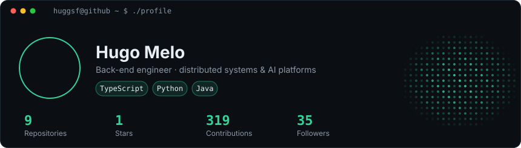
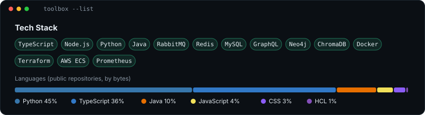
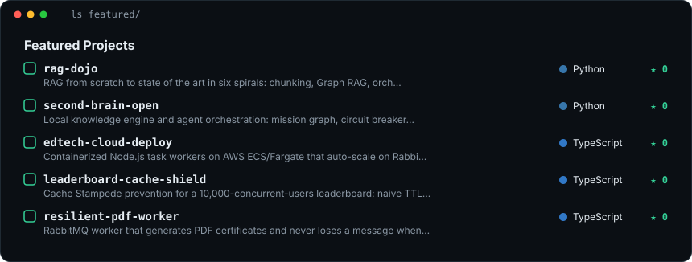
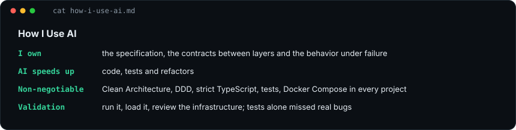
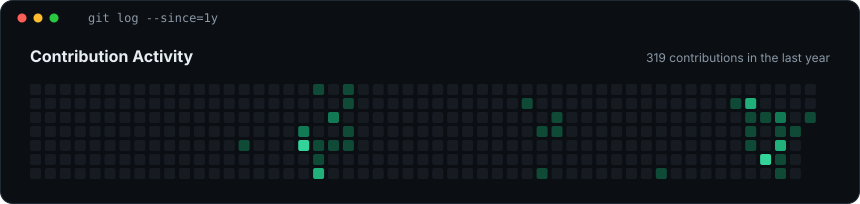
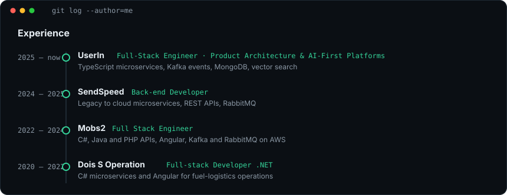
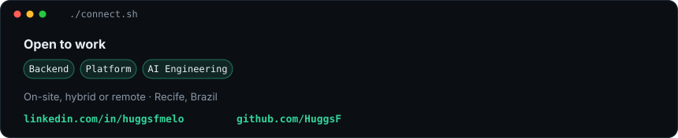

**Engenheiro back-end** em Recife, com foco em sistemas distribuídos, mensageria e plataformas com IA.
Trabalho com TypeScript, Node.js e Java, e já construí serviços orientados a eventos em produção.

Aberto a vagas de **Backend, Platform e AI Engineering** (presencial, híbrido ou remoto).
[LinkedIn](https://www.linkedin.com/in/huggsfmelo) · [hugofmelodev@gmail.com](mailto:hugofmelodev@gmail.com)

**Repositórios:**
[rag-dojo](https://github.com/HuggsF/rag-dojo) ·
[second-brain-open](https://github.com/HuggsF/second-brain-open) ·
[edtech-cloud-deploy](https://github.com/HuggsF/edtech-cloud-deploy) ·
[leaderboard-cache-shield](https://github.com/HuggsF/leaderboard-cache-shield) ·
[resilient-pdf-worker](https://github.com/HuggsF/resilient-pdf-worker) ·
[csv-stream-importer](https://github.com/HuggsF/csv-stream-importer) ·
[dashboard-bff-graphql](https://github.com/HuggsF/dashboard-bff-graphql)

