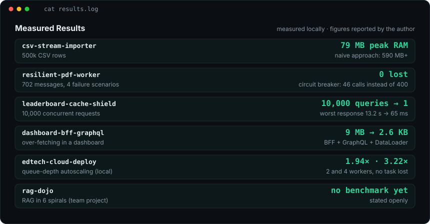

**Engenheiro back-end** em Recife, com foco em sistemas distribuídos, mensageria e plataformas com IA.
Trabalho com TypeScript, Node.js e Java, e já construí serviços orientados a eventos em produção.

Aberto a vagas de **Backend, Platform e AI Engineering** (presencial, híbrido ou remoto).
[LinkedIn](https://www.linkedin.com/in/huggsfmelo) · [hugofmelodev@gmail.com](mailto:hugofmelodev@gmail.com)

**Repositórios:**
[rag-dojo](https://github.com/HuggsF/rag-dojo) ·
[second-brain-open](https://github.com/HuggsF/second-brain-open) ·
[edtech-cloud-deploy](https://github.com/HuggsF/edtech-cloud-deploy) ·
[leaderboard-cache-shield](https://github.com/HuggsF/leaderboard-cache-shield) ·
[resilient-pdf-worker](https://github.com/HuggsF/resilient-pdf-worker) ·
[csv-stream-importer](https://github.com/HuggsF/csv-stream-importer) ·
[dashboard-bff-graphql](https://github.com/HuggsF/dashboard-bff-graphql)

Versão em texto (resultados e experiência)

| Projeto | Resultado medido |
|---|---|
| csv-stream-importer | 500 mil linhas de CSV no MySQL com pico de 79 MB de RAM. A abordagem ingênua passa de 590 MB |
| resilient-pdf-worker | 702 mensagens em 4 cenários de falha, nenhuma perdida. O circuit breaker deixou passar 46 chamadas em vez de 400 |
| leaderboard-cache-shield | 10.000 queries no MySQL com cache ingênuo contra 1 com stale-while-revalidate. Pior resposta: 13,2 s contra 65 ms |
| dashboard-bff-graphql | Resposta de 9 MB reduzida para 2,6 KB |
| edtech-cloud-deploy | Medido localmente: 2 workers entregam 1,94× a vazão e 4 entregam 3,22× |
| rag-dojo | Sem benchmark publicado. Estudo de RAG em 6 espirais, em equipe |

Números medidos localmente, com Docker Compose, e informados por mim no LinkedIn.

- **UserIn** (2025 até agora): arquitetura e desenvolvimento de uma plataforma de inteligência de conversão com IA. Microsserviços em TypeScript, eventos com Kafka, MongoDB e busca vetorial.
- **SendSpeed** (2024 a 2025): migração de serviços legados para microsserviços na nuvem, APIs REST e mensageria com RabbitMQ.
- **Mobs2** (2022 a 2024) e **Dois S Operation** (2020 a 2022): APIs e microsserviços em C#, Java e PHP, e front-end em Angular.

